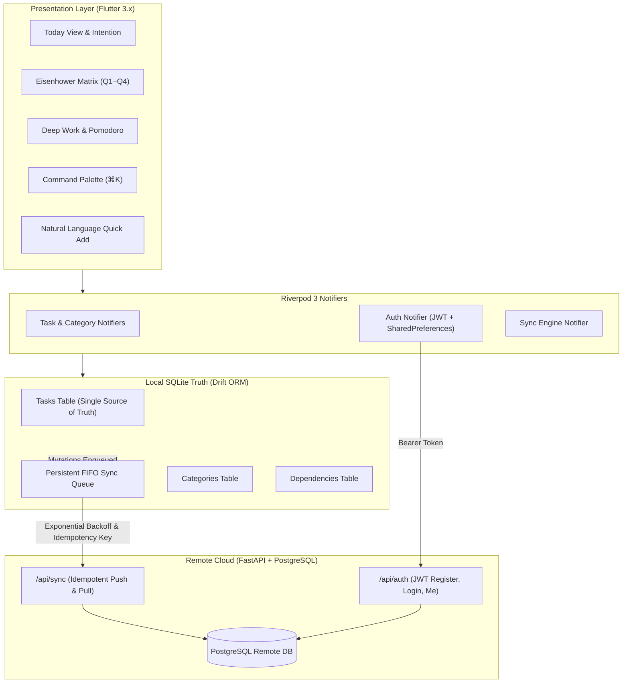

# IDEM — Offline-First Workstation

[](#automated-testing)
[](#backend-architecture)
[](#architecture)
[](#design-system)

**IDEM** (pronounced /ˈaɪ.dɛm/, derived from *Idempotence* and Latin *idem* — meaning "the same") is a commercial-grade, deterministic, offline-first productivity workstation. Built from the ground up for students, software engineers, researchers, and professionals, IDEM eliminates cognitive friction, cognitive overload, and cloud dependency.

Local SQLite storage is the single source of truth. Every action succeeds in sub-milliseconds without an internet connection. When connectivity is restored, an idempotent FIFO sync engine reconciles local mutations with the remote PostgreSQL/FastAPI cloud backend without duplicate records or lost writes.

---

## 1. Core Principles

1. **Deterministic Idempotence ($f(f(x)) = f(x)$)**: Sync retries across patchy networks never create duplicate records. Every mutation is addressed with a client-generated UUID and verified via an idempotency key log.
2. **Offline by Default, Not Fallback**: You can run this app entirely disconnected in an airplane, underground transit, or off-grid. The UI responds instantaneously to local SQLite queries.
3. **Calm Ergonomics**: Zero gamification, zero neon gradients, zero decorative dashboard bloat. Clean typography (Geist/Inter), whitespace, micro-interactions, and 7 subtle accent packs.
4. **Frictionless Authentication**: Full offline guest mode out of the box with zero forced login. Users can connect a cloud account anytime via JWT Bearer authentication to activate multi-device replication.

---

## 2. Complete Feature Matrix

### A. Task Management & Natural Language Engine
- **Full Offline CRUD**: Instant creation, modification, completion, and deletion backed by Drift SQLite.
- **Smart Natural Language Parser (`SmartTaskParser`)**:
  - Automatically parses priorities: `!high`, `!urgent`, `!p1`, `!med`, `!low`
  - Extracts categories on the fly: `#Work`, `#Personal`, `#DevOps`
  - Detects time estimates: `~30m`, `~1h`, `~45min`
  - Parses natural dates: `tomorrow at 5pm`, `tonight`, `today`, `17:00`
  - **Live Preview Chips**: Real-time interactive pill chips update below the Quick Add input as you type.
- **Hierarchical Subtask Checklists**: Break complex objectives into bite-sized actionable steps with inline progress tracking (`✓ N/M`).
- **Prerequisite Dependency Graph**: Tasks can declare dependencies. Blocked tasks show lock indicators with blocker alerts and automatically unblock when prerequisites are completed.
- **Recurring Habits & Routines**: Daily, Weekdays, Weekly, and Monthly cycles with automatic spawning of next instances upon completion.

### B. Strategic Prioritization & Planning Workstations
- **Eisenhower Priority Matrix (`/matrix`)**:
  - **Q1: Do First**: Urgent & Important (High priority, due within 48h)
  - **Q2: Schedule / Strategic**: Important, Not Urgent (High priority, long-term leverage)
  - **Q3: Delegate / Quick Wins**: Urgent, Lower Stakes (Due soon, standard priority)
  - **Q4: Backlog / Someday**: Low urgency, low impact
- **Morning Daily Planning Ritual**: Step-by-step workflow prompting users to commit to 3–5 core tasks for the day to prevent overwhelm.
- **Daily Intention Anchor**: Pin a singular core focus for the day to maintain deep cognitive alignment.
- **Deep Work & Pomodoro Workstation (`/focus`)**: Full-screen distraction-free workstation with 25m Focus, 50m Deep Work, 5m Breather, and Stopwatch modes. Automatically logs completed focus minutes directly to the active task.
- **Evening Shutdown Ritual**: Reflection sheet prompting review of completed work, guilt-free deferral of uncompleted items, and mental closure for the day.

### C. Authentication & Cloud Synchronization
- **Dual-Mode Authentication**:
  - **Offline Guest Mode**: 100% usable without registration or network access.
  - **Cloud Linked Mode**: Connect an email/password account authenticated via JWT Bearer tokens to sync with the FastAPI backend.
- **Crash-Safe FIFO Queue**: Mutations persist to local SQLite before being scheduled for network push. The queue survives app kills, crashes, and device restarts.
- **Exponential Backoff**: Dynamic retry delays (1s, 2s, 4s, 8s, 16s) to prevent network congestion.
- **Conflict Resolution**: Last-Write-Wins (LWW) timestamp comparison with optimistic server versioning.

### D. Navigation, Accessibility & Data Portability
- **Universal Command Palette (`⌘K` / `Ctrl+K`)**: Rapid fuzzy search across tasks, categories, screens, themes, and sync operations.
- **Responsive Layout**:
  - **Desktop / Web**: 230px persistent sidebar with numeric shortcuts (`⌘1`–`⌘6`), multi-column workspace, and mouse/keyboard ergonomics.
  - **Mobile**: Thumb-friendly bottom navigation bar with responsive layout adjustments.
- **Obsidian Slate Visual Design**:
  - Dark Mode (`#0F1115` base, `#171A21` surface, `#2B313C` border, `#F5F5F5` typography).
  - Warm Paper Light Mode (cream paper tones avoiding clinical pure-white glare).
  - 7 Curated Accent Packs: Forest, Ocean, Amber, Burgundy, Lavender, Slate, Monochrome.
- **Data Portability & Zero Lock-in**: One-tap export to structured Markdown (`# Task Export`) and raw JSON.

---

## 3. Architecture & Data Flow



---

## 4. Getting Started

### Prerequisites
- **Flutter SDK**: `^3.10.4` or later
- **Python**: `3.10+` (FastAPI backend)
- **Node/Chrome**: For web preview

### Running the Frontend
```bash
# Install dependencies
flutter pub get

# Run local web workstation
flutter run -d chrome --web-port 3000

# Or build release bundle
flutter build web --release
```

### Running the Backend
```bash
# Setup virtual environment and dependencies
pip install -r backend/requirements.txt

# Launch FastAPI synchronization server with hot reload
python -m uvicorn backend.app.main:app --host 127.0.0.1 --port 8000 --reload
```
Interactive Swagger API documentation is available at `http://127.0.0.1:8000/docs`.

---

## 5. Automated Testing

The codebase enforces strict test-driven reliability across local databases, synchronization semantics, parsers, and UI widgets:

```bash
# Run all Flutter tests (21/21 passing)
flutter test

# Run static analysis (0 warnings, 0 errors)
flutter analyze lib/ test/

# Run backend pytest suite (3/3 passing)
python -m pytest backend/tests/
```

---

## 6. Design System Tokens (Obsidian Slate)

| Token Name | Dark Hex | Light Hex | Purpose |
|:---|:---|:---|:---|
| **Background** | `#0F1115` | `#F8F9FA` | Main screen viewport backdrop |
| **Surface** | `#171A21` | `#FFFFFF` | Cards, sheets, dialogs, sidebar |
| **Secondary Surface** | `#20242C` | `#F1F3F5` | Input fields, active pills, badges |
| **Border** | `#2B313C` | `#E2E8F0` | Structural hairpins and dividers |
| **Primary Text** | `#F5F5F5` | `#1A202C` | High-contrast readable typography |
| **Secondary Text** | `#A1A8B3` | `#4A5568` | Supporting content and descriptions |
| **Muted Text** | `#6B7280` | `#718096` | Metadata, shortcut indicators, timestamps |
| **Accent Packs** | 7 Curated | 7 Curated | Subtle interactive focus indicators |
