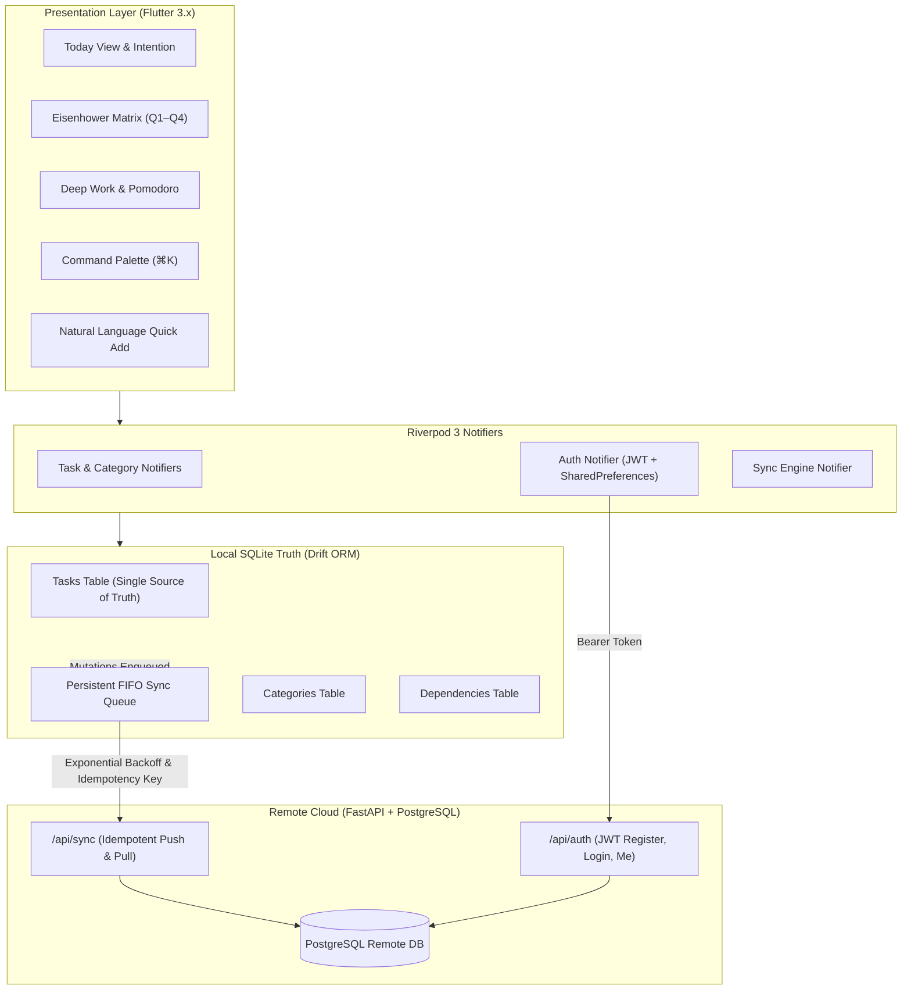

# IDEM — Offline-First Workstation

[](#automated-testing)
[](#backend-architecture)
[](#architecture)
[](#design-system)

**IDEM** (pronounced /ˈaɪ.dɛm/, derived from *Idempotence* and Latin *idem* — meaning "the same") is a commercial-grade, deterministic, offline-first productivity workstation. Built from the ground up for students, software engineers, researchers, and professionals, IDEM eliminates cognitive friction, cognitive overload, and cloud dependency.

Local SQLite storage is the single source of truth. Every action succeeds in sub-milliseconds without an internet connection. When connectivity is restored, an idempotent FIFO sync engine reconciles local mutations with the remote PostgreSQL/FastAPI cloud backend without duplicate records or lost writes.

---

## 1. Core Principles

1. **Deterministic Idempotence ($f(f(x)) = f(x)$)**: Sync retries across patchy networks never create duplicate records. Every mutation is addressed with a client-generated UUID and verified via an idempotency key log.
2. **Offline by Default, Not Fallback**: You can run this app entirely disconnected in an airplane, underground transit, or off-grid. The UI responds instantaneously to local SQLite queries.
3. **Calm Ergonomics**: Zero gamification, zero neon gradients, zero decorative dashboard bloat. Clean typography (Geist/Inter), whitespace, micro-interactions, and 7 subtle accent packs.
4. **Frictionless Authentication**: Full offline guest mode out of the box with zero forced login. Users can connect a cloud account anytime via JWT Bearer authentication to activate multi-device replication.

---

## 2. Complete Feature Matrix

### A. Task Management & Natural Language Engine
- **Full Offline CRUD**: Instant creation, modification, completion, and deletion backed by Drift SQLite.
- **Smart Natural Language Parser (`SmartTaskParser`)**:
  - Automatically parses priorities: `!high`, `!urgent`, `!p1`, `!med`, `!low`
  - Extracts categories on the fly: `#Work`, `#Personal`, `#DevOps`
  - Detects time estimates: `~30m`, `~1h`, `~45min`
  - Parses natural dates: `tomorrow at 5pm`, `tonight`, `today`, `17:00`
  - **Live Preview Chips**: Real-time interactive pill chips update below the Quick Add input as you type.
- **Hierarchical Subtask Checklists**: Break complex objectives into bite-sized actionable steps with inline progress tracking (`✓ N/M`).
- **Prerequisite Dependency Graph**: Tasks can declare dependencies. Blocked tasks show lock indicators with blocker alerts and automatically unblock when prerequisites are completed.
- **Recurring Habits & Routines**: Daily, Weekdays, Weekly, and Monthly cycles with automatic spawning of next instances upon completion.

### B. Strategic Prioritization & Planning Workstations
- **Eisenhower Priority Matrix (`/matrix`)**:
  - **Q1: Do First**: Urgent & Important (High priority, due within 48h)
  - **Q2: Schedule / Strategic**: Important, Not Urgent (High priority, long-term leverage)
  - **Q3: Delegate / Quick Wins**: Urgent, Lower Stakes (Due soon, standard priority)
  - **Q4: Backlog / Someday**: Low urgency, low impact
- **Linear-Grade Visual Kanban Workstation (`/board`)**:
  - 4 Strategic Obsidian Slate Swimlanes: `Backlog`, `To Do`, `In Progress`, and `Done`.
  - Rapid card movement with left/right directional shortcuts and quick dropdowns.
  - Subtask completion progress indicators (`✓ 3/5`), priority color pills (`P1`–`P4`), and inline card creation.
  - Seamlessly switchable directly within Today (`List` | `Timeline` | `Board`) or via dedicated workstation route (`⌘B` / `/board`).
- **Algorithmic Day Orchestrator (`SmartDayScheduler`)**:
  - 1-click intelligent day scheduler that packs pending tasks into energy-aligned blocks starting at 9:00 AM.
  - Prioritizes P1/P2 cognitive load for morning focus, protects a 45m lunch/recharge buffer at 12:30 PM, and slates routine execution for afternoons.
  - Evaluates total daily cognitive load (`Light`, `Optimal`, `Heavy`) and writes synchronized time-blocks directly to SQLite.
- **Daily Habits & Routines Cadence Engine**:
  - Persistent daily rituals strip with real-time streak flame counter (`🔥 7d`).
  - Tactile completion feedback, daily reset tracking, and custom habit creation with time-of-day slots (`Morning`, `Afternoon`, `Evening`).
- **Interactive Daily Time-Blocker & Timeline**:
  - Visual hour-by-hour day timeline (8:00 AM to 9:00 PM) with capacity metrics and drag/slotting support.
- **Morning Daily Planning Ritual & Intention Anchor**: Step-by-step workflow committing to 3–5 core tasks with a pinned North Star daily intention.
- **Evening Shutdown Ritual**: Reflection sheet prompting review of accomplishments, guilt-free deferral of uncompleted items, and clean mental closure.

### C. Flow State Ambient Soundscape Synthesizer
- **100% Offline Procedural Sound Engine**:
  - Procedural Web Audio API sound generation requiring zero megabytes of downloads, zero external streaming, and zero latency.
  - **Binaural 40Hz Gamma Focus**: Scientifically calibrated binaural beat (200Hz Left / 240Hz Right) for peak working memory and intense coding sessions.
  - **Deep Brown Noise**: Low-frequency oceanic rumble engineered for ADHD focus and masking environmental office chatter.
  - **Calm Pink Noise**: Balanced $1/f$ spectral balance for sustained cognitive endurance.
  - **Rain on Glass**: Procedural raindrops with ambient resonance.
  - **Pure White Noise**: High-frequency acoustic speech masking.
- **Box Breathing Reset Guide (4-4-4-4)**:
  - Guided vagus nerve reset widget: Inhale (4s) → Hold (4s) → Exhale (4s) → Rest (4s) with real-time expanding/contracting breathing ring.
- **Reactive Waveform Audio Dock**:
  - Compact top-bar and focus overlay dock featuring live oscillating soundwave visualizer bars.

### D. GitHub-Style 365-Day Productivity Heatmap & Reflection
- **Longitudinal Contribution Matrix**:
  - GitHub-style 52-week activity intensity grid mapping daily task completion counts to 5 obsidian slate luminance tiers.
  - Interactive day inspector tooltips displaying exact completion metrics and focus duration logged.
- **Velocity & Streak Analytics**:
  - Current Discipline Streak counter with consecutive-day momentum tracking.
  - All-Time Best Streak record.
  - Weekly Task Velocity and cognitive workload balance ratings.

### E. Authentication & Cloud Synchronization
- **Dual-Mode Authentication**:
  - **Offline Guest Mode**: 100% usable without registration or network access.
  - **Cloud Linked Mode**: Connect an email/password account authenticated via JWT Bearer tokens to sync with the FastAPI backend.
- **Crash-Safe FIFO Queue**: Mutations persist to local SQLite before being scheduled for network push. The queue survives app kills, crashes, and device restarts.
- **Exponential Backoff**: Dynamic retry delays (1s, 2s, 4s, 8s, 16s) to prevent network congestion.
- **Conflict Resolution**: Last-Write-Wins (LWW) timestamp comparison with optimistic server versioning.

### F. Navigation, Workstation HUD & Data Sovereignty
- **Omnipresent Workstation Header HUD**:
  - Real-time digital clock and date with clean monospace typography.
  - Daily completion progress ring (`8/12 done`).
  - Ambient soundscape audio pill with 1-click toggling.
  - Quick action shortcuts for Scratchpad (`⌘J`), Focus (`⌘F`), and Command Palette (`⌘K`).
- **Universal Command Palette (`⌘K` / `Ctrl+K`)**: Rapid fuzzy search across tasks, categories, screens, themes, and audio controls.
- **Global Scratchpad / Brain Dump (`⌘J` / `Ctrl+J`)**: Rapid ephemeral notepad with 1-click "Convert Lines to Tasks" parsing.
- **Data Sovereignty & Portability Engine**:
  - **Export to Markdown**: Generates clean daily logs formatted for Obsidian, Logseq, and Notion with markdown checkboxes and metadata.
  - **Backup Full Workspace (JSON)**: Complete portable export of tasks, categories, and settings.
  - **Batch Import from Markdown Checklist**: Paste any raw markdown checklist (e.g. `- [ ] Task #Work !urgent ~30m`); IDEM uses `SmartTaskParser` to generate real tasks with structured tags automatically.
- **Responsive Layout**:
  - **Desktop / Web**: 230px persistent sidebar with numeric shortcuts (`⌘1`–`⌘7`, `⌘B`), multi-column workspace, and mouse/keyboard ergonomics.
  - **Mobile**: Thumb-friendly bottom navigation bar with responsive layout adjustments.
- **Obsidian Slate Visual Design**:
  - Dark Mode (`#0F1115` base, `#171A21` surface, `#2B313C` border, `#F5F5F5` typography).
  - Warm Paper Light Mode (cream paper tones avoiding clinical pure-white glare).
  - 7 Curated Accent Packs: Forest, Ocean, Amber, Burgundy, Lavender, Slate, Monochrome.

---

## 3. Architecture & Data Flow



---

## 4. Getting Started

### Prerequisites
- **Flutter SDK**: `^3.10.4` or later
- **Python**: `3.10+` (FastAPI backend)
- **Node/Chrome**: For web preview

### Running the Frontend
```bash
# Install dependencies
flutter pub get

# Run local web workstation
flutter run -d chrome --web-port 3000

# Or build release bundle
flutter build web --release
```

### Running the Backend
```bash
# Setup virtual environment and dependencies
pip install -r backend/requirements.txt

# Launch FastAPI synchronization server with hot reload
python -m uvicorn backend.app.main:app --host 127.0.0.1 --port 8000 --reload
```
Interactive Swagger API documentation is available at `http://127.0.0.1:8000/docs`.

---

## 5. Automated Testing

The codebase enforces strict test-driven reliability across local databases, synchronization semantics, parsers, and UI widgets:

```bash
# Run all Flutter tests (21/21 passing)
flutter test

# Run static analysis (0 warnings, 0 errors)
flutter analyze lib/ test/

# Run backend pytest suite (3/3 passing)
python -m pytest backend/tests/
```

---

## 6. Design System Tokens (Obsidian Slate)

| Token Name | Dark Hex | Light Hex | Purpose |
|:---|:---|:---|:---|
| **Background** | `#0F1115` | `#F8F9FA` | Main screen viewport backdrop |
| **Surface** | `#171A21` | `#FFFFFF` | Cards, sheets, dialogs, sidebar |
| **Secondary Surface** | `#20242C` | `#F1F3F5` | Input fields, active pills, badges |
| **Border** | `#2B313C` | `#E2E8F0` | Structural hairpins and dividers |
| **Primary Text** | `#F5F5F5` | `#1A202C` | High-contrast readable typography |
| **Secondary Text** | `#A1A8B3` | `#4A5568` | Supporting content and descriptions |
| **Muted Text** | `#6B7280` | `#718096` | Metadata, shortcut indicators, timestamps |
| **Accent Packs** | 7 Curated | 7 Curated | Subtle interactive focus indicators |
