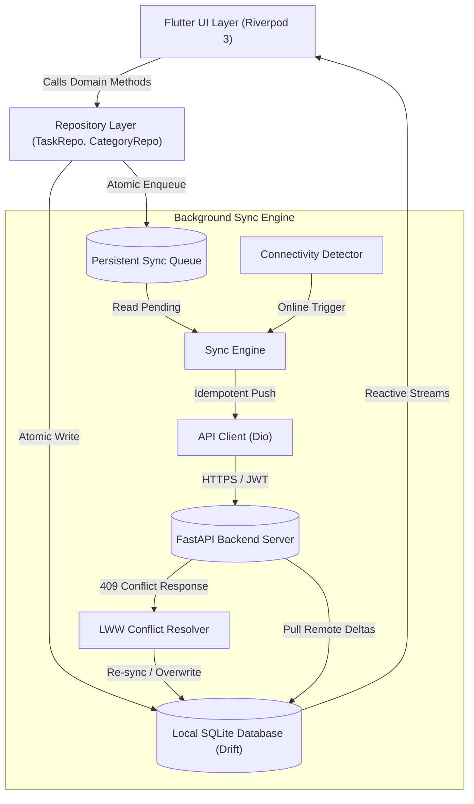

# Obsidian Slate: Offline-First Architecture & Engineering Specification

Obsidian Slate is engineered around a core tenet: **Offline is not a fallback state; offline is the fundamental default.** Every user operation completes locally and synchronously within milliseconds, providing an immediate, calm, and interruption-free experience regardless of network volatility.

---

## 1. High-Level Architecture Flow

---

## 2. The Persistent Sync Queue

When a user creates, edits, completes, snoozes, reorders, or deletes a task, the repository performs two actions atomically:
1. Writes the changes to the local SQLite table (`tasks`).
2. Inserts a new `SyncOperation` record into the `sync_queue` table with a client-generated UUID v4.

### Why This Guarantees Zero Data Loss
Even if the application is killed, crashes, or the device loses power half a millisecond later, the mutation remains committed to non-volatile disk storage. When the application restarts, the `SyncEngine` scans the persistent queue and resumes synchronization exactly where it left off.

---

## 3. Idempotency & Duplicate Prevention

A common bug in naive sync implementations is record duplication caused by network dropouts:
- Client uploads `Task A` to server.
- Server receives and inserts `Task A`.
- Network drops before server's HTTP 200 response reaches the client.
- Client retries, creating `Task A (1)` on the server.

### Prevention Mechanism
- Every entity and every operation has a client-generated UUID v4 (`id`).
- All push requests send an `X-Idempotency-Key: <operation_uuid>` HTTP header.
- The backend checks whether the `operation_id` or `task.id` has already been recorded. If already present, it treats the request as an idempotent update and returns HTTP 200 without creating duplicate records.

---

## 4. Exponential Backoff Retry Strategy

When an operation fails due to transient network dropouts or server timeouts:
- The retry counter (`attempts`) increments by 1.
- The next retry schedule is calculated:
  $$\text{delay} = 2^{\text{attempts}} \text{ seconds}$$
  - Attempt 1: 1s delay
  - Attempt 2: 2s delay
  - Attempt 3: 4s delay
  - Attempt 4: 8s delay
  - Attempt 5: 16s delay
- If `attempts >= maxAttempts` (default: 5), the operation status transitions to `failed` and the user is calmly alerted via the Sync Diagnostics panel without blocking ongoing local work.

---

## 5. Conflict Resolution: Last-Write-Wins (LWW)

When two devices edit the same task concurrently while offline:
- Each task entity tracks an ISO-8601 `updated_at` timestamp and an integer `server_version`.
- When an operation is submitted to the server:
  - If the server has a newer timestamp or higher version, it rejects the operation with `HTTP 409 Conflict` containing the server's authoritative record.
  - The `SyncEngine` compares `client.updatedAt` vs `server.updatedAt`:
    - **Server is newer**: Overwrites local record with server state, updates local SQLite, and marks the queue entry completed.
    - **Client is newer**: Submits a `FORCE_UPDATE` to bring the server up to date.
- Conflicts are handled invisibly and calmly without interrupting the user's flow.

---

## 6. Multiplatform Strategy

Obsidian Slate targets:
- **Android**: Single-column layout with thumb-friendly bottom navigation.
- **Windows Desktop**: Expanded canvas with persistent sidebar navigation, resizable panels, and keyboard shortcuts.
- **Linux Desktop**: Native GTK/X11 styling harmony with matching dark theme integration.
- Codebase is 100% unified under a single Flutter repository using responsive layout breakpoints:
  - Mobile: `< 768px` width.
  - Desktop: `≥ 768px` width.
